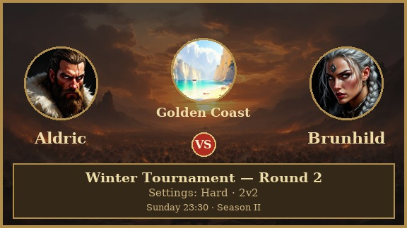
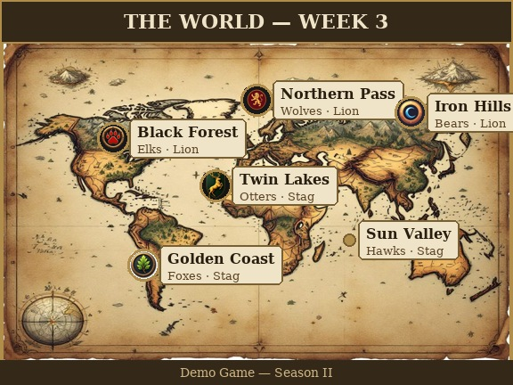
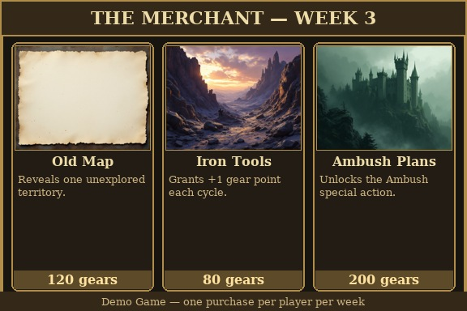
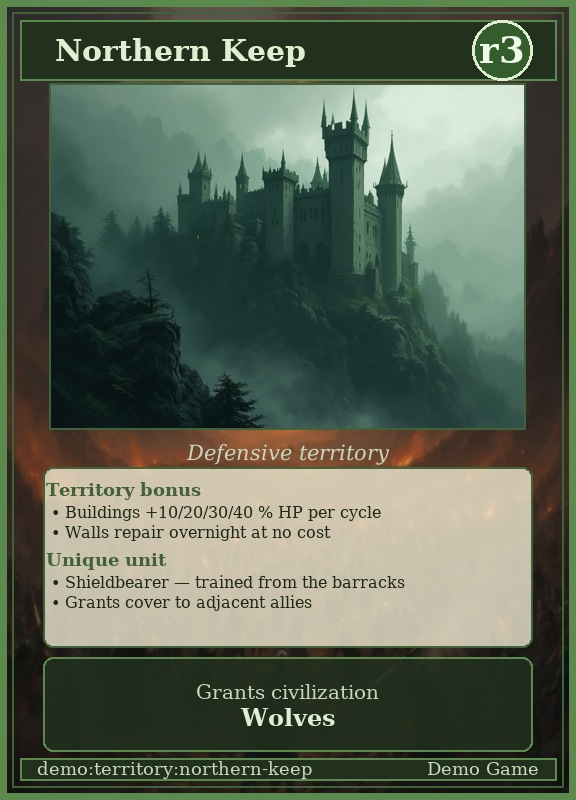
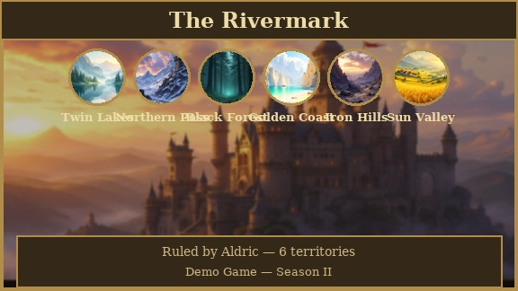

# visual-generator

A generic, data-driven visual generator: **JSON + template + art + text
sections**. Any visual — match announcement, annotated world map,
merchant shop, entity card, kingdom sheet — is defined by:

- a **JSON data file** — the content (names, texts, numbers, image paths);
- a **template** — a Python layout module;
- **art** — image-model generated pictures (or real game assets),
  never carrying text;
- **text sections** — drawn by the engine with a real vector font,
  which makes every output OCR-verifiable.

The engine and templates are project-agnostic: all game-specific
content lives in the JSON data files of the consuming project.

## Install

```bash
pip install visual-generator        # or: uv add visual-generator
```

- Runtime dependency: **Pillow only**.
- **Fonts**: the engine draws with DejaVu Serif. It auto-locates the
  system fonts (e.g. `fonts-dejavu` on Debian/Ubuntu) or the
  [matplotlib](https://pypi.org/project/matplotlib/) bundle — install
  the light extra if your system has neither:
  `pip install "visual-generator[fonts]"`. `--font-dir` overrides.
- **OCR check** (recommended, optional): requires
  [tesseract](https://github.com/tesseract-ocr/tesseract) with the
  `fra` and `eng` languages (`apt-get install tesseract-ocr
  tesseract-ocr-fra`).

## Quick start

A visual is one JSON file. The `template` key selects the layout;
`sections` carries the content (schema per template below).

```json
{
  "template": "match_announcement",
  "output": "out/match.jpg",
  "art": "assets/battle.jpg",
  "sections": {
    "left_name": "Aldric",
    "left_avatar": "assets/avatar_aldric.png",
    "right_name": "Brunhild",
    "right_avatar": "assets/avatar_brunhild.png",
    "map_art": "assets/terr_golden-coast.jpg",
    "map_name": "Golden Coast",
    "vs": "VS",
    "context_line": "Winter Tournament — Round 2",
    "sub_line": "Settings: Hard · 2v2",
    "footer": "Sunday 23:30 · Season II"
  }
}
```

Render and validate (fail-closed: non-zero exit on any defect):

```bash
vg-render --data out/match.json
vg-ocr-check --data out/match.json
```

Or from Python:

```python
from visual_generator import render_file, check_file

render_file("out/match.json")
assert check_file("out/match.json") == []   # missing strings, if any
```

## Public API

`visual_generator` — the stable surface consumed by integrations
(BotForge and friends). Breaking changes before 1.0 go through a 0.x
bump (SemVer).

| Name | Signature | Purpose |
|---|---|---|
| `render_visual` | `(data: dict, font_dir: str \| None = None, out: str \| None = None) -> str` | Render an in-memory visual dict; returns the output path |
| `render_file` | `(path: str, font_dir=None, out=None) -> str` | Same, from a JSON file |
| `check_visual` | `(data: dict, transcript: str \| None = None) -> list[str]` | Expected strings missing from the OCR transcript of `data["output"]` (empty = pass) |
| `check_file` | `(path: str) -> list[str]` | Same, from the JSON file |
| `collect_strings` | `(obj) -> list[str]` | Every string the JSON contributes to the visual's text |
| `load_fonts` | `(font_dir: str \| None = None) -> dict` | DejaVu Serif font paths (`b`/`r`/`i`), used by templates |
| `list_templates` | `() -> list[str]` | Available template names |
| `template_structure` | `(name: str) -> dict` | Declared structure of a template: canvas + zones |

CLIs (same fail-closed contract): `vg-render`, `vg-ocr-check`,
`vg-demo-assets` (procedural stand-in art — text-free, no image model
needed; the shipped `examples/assets/` are image-model generated).

## Targets and declared structure

Every shipped template targets **Discord embeds**: the default canvas
is **under 600 px wide** so the image displays inline in an embed.
Each template declares its structure — the canvas and the named zones
(image or text) where the consumer integrates its data. The consumer
fills the zones with the right data; the template owns the geometry.

```python
from visual_generator import template_structure

template_structure("match_announcement")
# {"canvas": {"width": 576, "height": 324}, "target": "discord-embed",
#  "zones": {"left_avatar": {"kind": "image", "rect": [...], "note": ...},
#            "left_name": {"kind": "text", ...}, ...}}
```

## The one hard rule

**The image model never renders text.** Image models produce
convincing-looking but misspelled pseudo-text. Every word on a visual
is drawn by the engine from the JSON — the only way to guarantee
correct text and prove it by OCR.

## Templates and data schemas

Every visual JSON carries `template`, `output`, and optionally
`canvas` (`{"width", "height"}`), `palette` (hex overrides of the
template's documented palette keys), `art` (path(s) to text-free
art). `sections` is the template's content, schemas below — this is
the contract consuming projects write into their JSON. Art paths are
relative to the working directory of the render call.

### `match_announcement` — two players, one place, the context



576×324. Round avatar medallions with pseudos, battle map medallion
in the center, VS badge, bottom band for the context (tournament /
settings / time). Pseudos ≈ 14 characters max per side.

```json
{ "art": "assets/battle.jpg", "sections": {
    "left_name": "Aldric", "left_avatar": "assets/avatar_aldric.png",
    "right_name": "Brunhild", "right_avatar": "assets/avatar_brunhild.png",
    "map_art": "assets/terr_golden-coast.jpg", "map_name": "Golden Coast",
    "vs": "VS", "context_line": "Winter Tournament — Round 2",
    "sub_line": "Settings: Hard · 2v2", "footer": "Sunday 23:30 · Season II" } }
```

### `world_map` — annotated map with crest spots



576×432. Real map art background, one spot per territory at its
geographic position: a colored pin, or a **crest spot** (round
medallion carrying the region's crest/icon — `icon` key). `x`/`y`
are pixel coordinates on the canvas (title band: top 48 px, footer
band: bottom 28 px). **Place regions on actual land** — inspect the
map art first; pins in the ocean are a defect.

```json
{ "art": "assets/world_map_art.jpg", "sections": {
    "title": "THE WORLD — WEEK 3", "footer": "Demo Game — Season II",
    "regions": [ { "name": "Black Forest", "x": 245, "y": 98,
                   "color": "#5c8a4e", "note": "Elks · Lion",
                   "icon": "assets/crest_lion.png" } ] } }
```

### `merchant` — product sheets side by side



576×384. Titled row of product cards: art window, name, short
description, price on a gold band. `columns` defaults to 3 (max 4);
extra products wrap. Keep descriptions short (≈ 2 lines per card).

```json
{ "sections": {
    "title": "THE MERCHANT — WEEK 3", "columns": 3,
    "products": [ { "art": "assets/parchment.jpg", "name": "Old Map",
                    "description": "Reveals one unexplored territory.",
                    "price": "120 gears" } ],
    "footer": "Demo Game — one purchase per player per week" } }
```

### `entity_card` — one entity's sheet



576×800 (scales with `canvas`). Collector-card anatomy: name banner +
badge, art window over a translucent backdrop, parchment plates
(heads + lines), optional linked-value box. The territory /
civilization / player card case — any entity with a visual and a
description.

```json
{ "art": "assets/entity_art.jpg", "backdrop": "assets/scene.jpg", "badge": "r3",
  "sections": {
    "title": "Northern Keep", "type_line": "Defensive territory",
    "plates": [ { "head": "Territory bonus",
                  "lines": ["Buildings +10/20/30/40 % HP per cycle", "…"] } ],
    "extra_label": "Grants civilization", "extra_value": "Wolves",
    "footer_left": "demo:territory:northern-keep", "footer_right": "Demo Game" } }
```

### `kingdom` — a realm's owned territories



576×324. Castle scene as the background (`art`, veiled), kingdom
name in the top band, the icon of every owned territory in a
centered row (optional caption under each), bottom band for the
ruler line. Up to 8 icons fit in the row.

```json
{ "art": "assets/castle.jpg", "sections": {
    "title": "The Rivermark",
    "icons": [ { "art": "assets/terr_twin-lakes.jpg", "caption": "Twin Lakes" } ],
    "subtitle": "Ruled by Aldric — 6 territories",
    "footer": "Demo Game — Season II" } }
```

Each template also documents its schema in its module docstring
(`visual_generator/templates/<name>.py`), and every `data/*.json` in
this repo is a working example.

## Agent skill

This repository ships the canonical agent skill for the library:
[`.agents/skills/visual-generator/SKILL.md`](.agents/skills/visual-generator/SKILL.md)
(plus its [`scripts/render_and_check.py`](.agents/skills/visual-generator/scripts/render_and_check.py)
batch helper). Any project using the library should point its agents
at that skill: it documents the install, the CLIs, the per-template
JSON schemas, the OCR validation contract and the known pitfalls —
everything needed to reproduce the reference rendering.

## Principles

1. **The image model never renders text** (see above).
2. **Data is the source of truth** — edit the JSON, re-render, never
   edit the image.
3. **Templates own the layout** — zone positions are fixed fractions
   of the canvas; art is center-cropped into its window and never
   shifts the text zones.
4. **Every output must pass OCR** before delivery.
5. **Assets are content, not decoration** — the JSON references the
   real game assets (avatars, crests, map thumbnails); the renderer
   places them, it never invents them.

## Versioning and publishing

Version **0.1.0** — the first publiable release. SemVer applies: the
public API is young, breaking changes before 1.0 go through a 0.x
bump.

Releases are published by the repo owner: pushing a `v*` tag (or
dispatching the workflow manually) triggers
[`.github/workflows/publish.yml`](.github/workflows/publish.yml):
`uv build` → `twine check` → publish to PyPI with the `PYPI_TOKEN`
secret. Nothing is published without that secret being set by the
owner.

## Project layout

```
├── AGENTS.md               ← agent instructions (rules, workflow)
├── .agents/skills/         ← agent skill (visual generation pipeline)
├── visual_generator/       ← the pip-installable package
│   ├── engine.py           ← core renderer (templates, palettes, fonts)
│   ├── ocr.py              ← OCR validation (fail-closed, importable)
│   ├── demo_assets.py      ← procedural demo art (no text, no model)
│   └── templates/          ← one layout module per visual kind
├── tests/                  ← render + OCR suite (runs in CI)
├── data/                   ← JSON examples (source of truth per visual)
└── examples/               ← rendered outputs + their assets
```

License: MIT.
