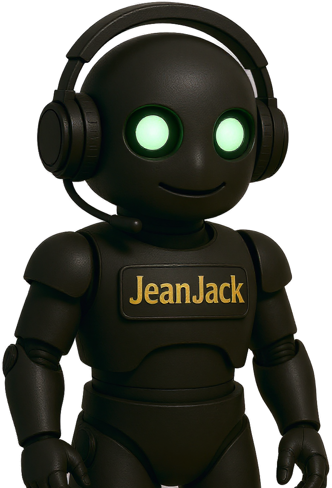

# visual-generator

A generic, data-driven visual generator: **JSON + template + art + text
sections**. Any visual — TCG card, match announcement, gallery,
annotated world map, parchment rules poster — is defined by:

- a **JSON data file** — the content (names, texts, numbers, image paths);
- a **template** — a Python layout module in `templates/`;
- **art** — image-model generated pictures (or real game assets),
  never carrying text;
- **text sections** — drawn by the engine with a real vector font,
  which makes every output OCR-verifiable.

Any game can use it: the engine and templates are project-agnostic,
and all game-specific content lives in the JSON data files of the
consuming project.

## Examples

### TCG card (`card_tcg`)


Cost is drawn as repeated gear icons (Magic-style currency icons).

### Match announcement (`match_announcement`)


Attacker's civilizations under the crest, battle map in the central
medallion.

### Gallery (`gallery`)


### Annotated world map (`world_map`)


Regions pinned on the map art at their geographic positions.

### Entity card (`entity_card`)

One entity's sheet, collector-card style: name banner + badge, art
window over a translucent backdrop, parchment plates for the content,
optional linked-value box — the civilization / map / player card case.

### Parchment rules poster (`parchment_poster`)


Texture background, auto-fitted multi-column rules text.

## Avatar generation (`tools/make_avatar.py`)

Square avatars composed from **two generated elements** — a
character and a background — through a dedicated, element-based
pipeline (not the JSON/template engine). Each element is generated
once and never edited: if a criterion fails, the element is
regenerated; compositing (crop, scale, position, blur) is the only
allowed transformation.

### Asset naming convention

| Prefix | Meaning | Stage |
|---|---|---|
| `raw_<name>.png` | generated, untouched | character render on a flat background |
| `raw_bg_<name>.png` | generated, untouched | sharp background scene |
| `cutout_<name>.png` | extracted | transparent character (interstices kept) |
| `bg_<name>_blurry.png` | prepared background | square crop + blur |
| `avatar_<name>.png` | **final** | assembled, cropped, size-bound — profile-picture ready |

Candidates under selection are numbered: `raw_JeanJack_01.png`,
`raw_bg_LAN_01.png`, …

| raw render | cutout | raw scene | blurry background | avatar |
|---|---|---|---|---|
|  |  |  |  |  |

### Step by step

```bash
# 1. prepare the background: square center-crop + Gaussian blur
python tools/make_avatar.py bg \
    --src examples/assets/jeanjack/raw_bg_LAN.png \
    --out examples/assets/jeanjack/bg_LAN_blurry.png --blur 5

# 2. cut out the character (rembg, alpha matting tuned for thin arms
#    and headset interstices)
python tools/make_avatar.py cutout \
    --src examples/assets/jeanjack/raw_JeanJack.png \
    --out examples/assets/jeanjack/cutout_JeanJack.png

# 3. compose the avatar — anchor auto-detected on the nameplate
python tools/make_avatar.py compose \
    --bg examples/assets/jeanjack/bg_LAN_blurry.png \
    --character examples/assets/jeanjack/cutout_JeanJack.png \
    --out examples/assets/jeanjack/avatar_JeanJack.png
```

The framing is anchor-driven and encoded in the CLI defaults:
**15%** of the frame free above the head, the nameplate anchor at
**85%** of the height (≈15% of body visible below it, then cut
flush by the bottom edge), centering on the anchor — never on the
arms — and ~25% of background visible left and right. The avatar is
a square 896 px PNG under 1 MB; the pipeline **fails closed** if the
size bound cannot be met (missing art and undetectable anchors abort
too).

Programmatic use (bots, drivers) imports the same core:

```python
from engine import avatar
avatar.prepare_background("raw_bg_LAN.png", "bg_LAN_blurry.png", blur=5)
avatar.cutout_character("raw_user.png", "cutout_user.png")
avatar.build_avatar("bg_LAN_blurry.png", "cutout_user.png", "avatar_user.png")
```

### Generating the raw elements

Prompts that produced the reference assets (adapt the description,
keep the constraints):

**`raw_user.png`** — flat uniform background, full body, empty hands:

> Full-body 3D render of `<character>` on a completely flat uniform
> plain light-gray studio background, centered, full figure visible
> head to feet, empty hands. `<identity: colors, headset, face — eyes,
> mouth, explicit omissions>`. Nothing held, nothing on the back.

**`bg_*.png`** — sharp scene, center uncluttered, no text:

> `<scene>` — center of the frame relatively uncluttered, no visible
> readable text, no logos. Natural photography look, sharp focus,
> high detail, action in the middle distance.

The reference scene: *“a LAN party in an attic, around ten people
> playing a real-time strategy game for hours — long tables with
> monitors, cables, warm light from desk lamps, evening atmosphere
> through a small roof window.”*

Agent-facing criteria for both generations, the QA checklist and the
ask-if-absent constraints (aspect, size bound) live in the
[avatar skill](.agents/skills/avatar/SKILL.md).

## Agent skill

This repository ships the canonical agent skill for the library:
[`.agents/skills/visual-generator/SKILL.md`](.agents/skills/visual-generator/SKILL.md)
(plus its [`scripts/render_and_check.py`](.agents/skills/visual-generator/scripts/render_and_check.py)
batch helper). Any project using the library should point its agents
at that skill: it documents the install, the CLIs, the per-template
JSON schemas, the OCR validation contract and the known pitfalls —
everything needed to reproduce the reference rendering.

## The one hard rule

**The image model never renders text.** Image models produce
convincing-looking but misspelled pseudo-text. Every word on a visual
is drawn by the engine from the JSON — the only way to guarantee
correct text and prove it by OCR.

## Project layout

```
├── AGENTS.md               ← agent instructions (rules, workflow)
├── .agents/skills/         ← agent skill (visual generation pipeline)
├── engine/render.py        ← core renderer (templates, palettes, fonts)
├── tools/ocr_check.py      ← OCR validation (fail-closed)
├── tools/make_demo_assets.py ← procedural demo art (no text, no model)
├── templates/              ← one layout module per visual kind
│   ├── card_tcg.py           TCG card (fixed anatomy, gear-icon costs)
│   ├── match_announcement.py Discord-sized X-vs-Y banner
│   ├── gallery.py           N-items grid with captions
│   ├── world_map.py         annotated map (geo-placed region pins)
│   ├── parchment_poster.py  rules poster on a parchment texture
│   └── entity_card.py       one entity's sheet (civ/map/player)
├── data/                   ← JSON examples (source of truth per visual)
└── examples/               ← rendered outputs + their assets
```

## Usage

Install (pip or uv):

```bash
uv add visual-generator        # or: pip install visual-generator
```

CLIs provided by the package:

```bash
vg-demo-assets                                   # demo art -> examples/assets/
vg-render --data data/card_ambush.json           # render
vg-ocr-check --data data/card_ambush.json       # validate (fail-closed)
```

From a repo checkout the module paths still work
(`python engine/render.py --data …`, `python tools/ocr_check.py …`).

The `template` key selects the layout module. Each template documents
its JSON schema in its docstring; each `data/*.json` is a working
example.

## Principles

1. **The image model never renders text** (see above).
2. **Data is the source of truth** — edit the JSON, re-render, never
   edit the image.
3. **Templates own the layout** — zone positions are fixed fractions
   of the canvas; art is center-cropped into its window and never
   shifts the text zones.
4. **Every output must pass OCR** before delivery.
5. **Assets are content, not decoration** — the JSON references the
   real game assets (crests, map thumbnails, civilization icons); the
   renderer places them, it never invents them.

## Status

Prototype, validated on a 10-card technology deck, a 48-card
territory deck, a parchment rules poster and the five templates
above, with project-agnostic data. Roadmap: extract a proper
pip-installable library (see the issues) with a plugin API for
templates and art providers.

License: MIT.
