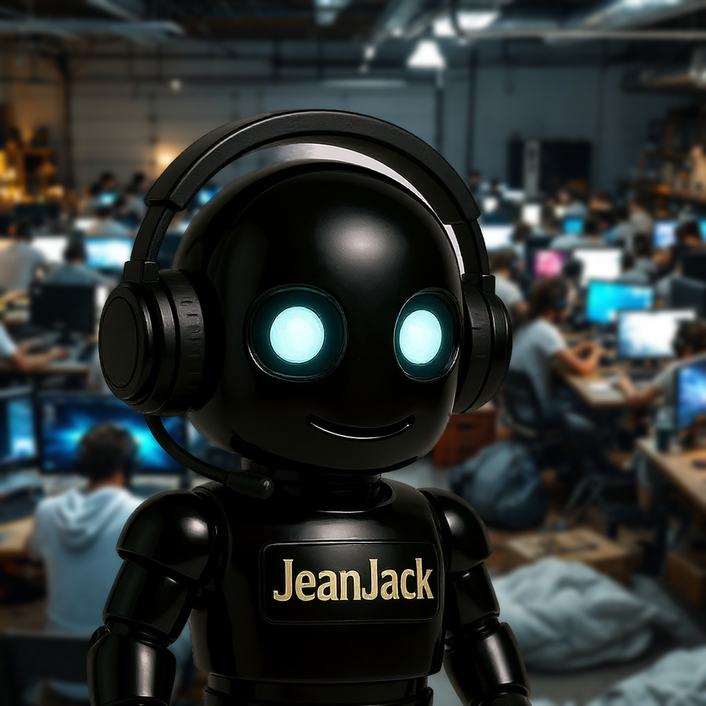

# Avatar recipe — JeanJack on LAN background

Combines `examples/character/JeanJack/crop.png` and
`examples/scene/lan/background.png` into
`examples/avatar/JeanJack.png` (PNG when it fits the bound, JPEG
fallback otherwise). Every parameter below was validated
during the jj-guild avatar session; nothing here is arbitrary.



```bash
# 1. background: square center-crop + Gaussian blur
#    --blur 4: the scene stays readable as a LAN party while the
#    character detaches from it (5 was too strong, 3 was refused).
python tools/make_avatar.py bg \
    --src examples/scene/lan/raw.png \
    --out examples/scene/lan/background.png --blur 4

# 2. crop: transparent character (rembg, soft alpha matting tuned
#    for thin arms and headset interstices)
python tools/make_avatar.py cutout \
    --src examples/character/JeanJack/raw.png \
    --out examples/character/JeanJack/crop.png

# 3. avatar: anchor-driven composition, size bound passed
#    explicitly — it is a per-request constraint, never a universal
#    default; ask the user when absent. This case asks for < 1 MB
#    (999,424 bytes = 976 KiB).
#    --anchor: measured plate position on this crop. The auto
#    detector drifts on this render (0.51 vs 0.58 measured) —
#    ALWAYS verify the auto-detected anchor against a manual plate
#    measurement, and pass the measured fractions when it drifts.
python tools/make_avatar.py compose \
    --bg examples/scene/lan/background.png \
    --character examples/character/JeanJack/crop.png \
    --out examples/avatar/JeanJack.png \
    --anchor 0.5787,0.6006 --max-kb 976
```

## Retained parameters (user-validated)

| Parameter | Value | Reason |
|---|---|---|
| `--blur` | 4 | background readable, character detached |
| `--anchor` | 0.5787,0.6006 | measured nameplate position; the auto-detection drifts on glossy renders |
| `--brightness` | none | character and scene are both natively bright; brightness correction is allowed only on explicit user request |
| `--max-kb` | 976 | the < 1 MB bound of THIS case; per-request, ask when absent |

## Size-bound behavior (per-request)

- PNG first; here the lossless PNG fits the bound (890 KB for the
  999,424-byte ask) so no compression at all was needed.
- If the bound is set and the PNG exceeds it, the pipeline falls
  back to JPEG and searches for the HIGHEST quality whose file size
  stays under the bound — approaching the requested limit for
  maximum quality, never settling for an undersized file.
- Fail-closed: if even the minimum quality cannot fit, nothing is
  delivered.
