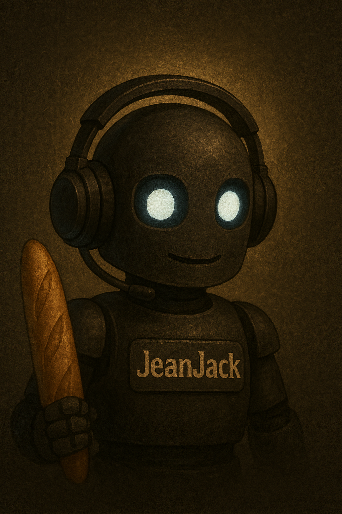

# Character prompt — JeanJack (raw generation)

Generate `raw.png` for this character. Every rule below was validated
during the jj-guild avatar session; nothing here is arbitrary.

## Reference

`original.png` is the identity reference — the generated character
must be recognizably the SAME character (same proportions, same head
shape, same gold nameplate), not a crop of the reference.

## Prompt used (edit of the user's reference, not of a prior
generation)

> Regenerate this exact same robot character with a brighter, evenly
> lit look. Keep the identity identical: same proportions and
> rounded head shape, glowing round bright golden-yellow eyes, same
> small subtle closed-mouth smirk (no teeth, no nose), same large
> gaming headset with an attached microphone reaching under the
> mouth, same small gold nameplate on the chest reading "JeanJack",
> slim three-finger robot hands. Changes: remove the baguette and
> everything held in his hands (empty hands held slightly away from
> the body), make the body a brighter medium warm-brown glossy metal
> with soft even highlights across the whole figure, completely
> uniform bright soft studio lighting with no dark areas and no
> shadows, full body visible head to feet, standing on a completely
> flat uniform light-gray background. Sharp focus, high detail, no
> other objects, no readable text other than the nameplate.

## Why each constraint (session-validated)

- **brighter medium warm-brown glossy metal, uniform lighting** —
  the first render was dark matte brown; against the LAN background
  the character read too dark (user: "he is too dark, brighten him,
  light him evenly"). The identity stays, the exposure changes;
- **flat uniform background** — the crop step depends on it;
- **full body visible** — the pipeline crops, the render must not;
- **empty hands, nothing on the back** — held items (the baguette)
  failed every generation attempt; the user dropped them;
- **no nose** — explicitly rejected by the user;
- **small closed-mouth smirk** — every larger smile rendered creepy;
- **microphone attached to the headset, ending under the mouth** —
  free-floating or chin-mounted microphones appeared repeatedly;
- **no readable text except the nameplate** — the model misspells
  text.

## Blocking criteria before accepting a run

1. Recognizably the same character as `original.png` (zoom on the
   face before anything else).
2. Full body visible, flat background, empty hands.
3. One microphone only, attached to the headset.
4. No nose, closed-mouth smirk.
5. Bright, uniform lighting — no dark areas, no shadows on the body.
6. Resolution ≥ 1024 px (the raw is never downscaled).
