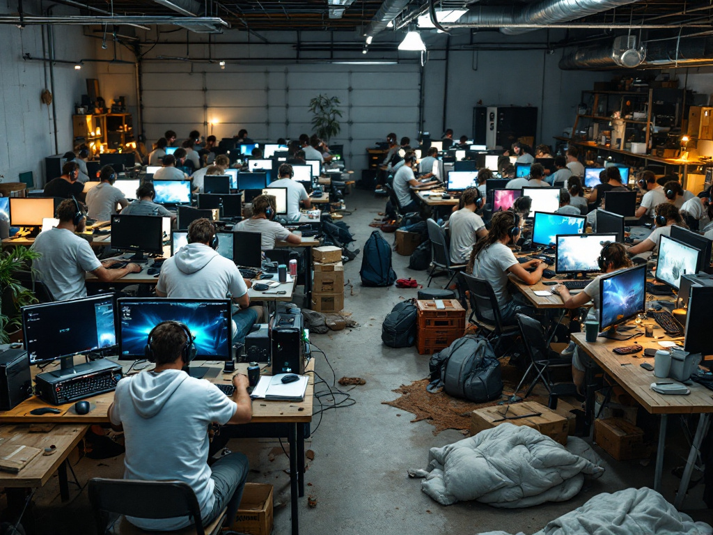

# Scene prompt — LAN party (raw generation)

Generate `raw.png` for this scene. Every rule below was validated
during the jj-guild avatar session; nothing here is arbitrary.

## Prompt used

> Photorealistic candid photo of a packed, messy modern LAN party in
> a windowless garage workshop. Even, bright, neutral ambient light
> fills the space from no visible source — no windows, no lamps, no
> ceiling fixtures in frame, everything clearly lit, warm lived-in
> tones, no dark corners. Around twenty gamers wearing light-colored
> clothing — white, beige, pale grey t-shirts and hoodies — with
> gaming headsets sit crammed at folding tables arranged at
> mismatched haphazard angles filling the room, each player seated
> directly in front of their own modern thin LCD monitor facing
> them, screens aimed in different directions — no rows, no central
> aisle, the space fully packed. Each setup: modern flat-screen
> monitor, LED-backlit, mechanical keyboard, mouse, headset, sleek
> PC tower. Authentic clutter: tangled ethernet cables, power
> strips, a network switch on a crate, empty soda cans, energy
> drink bottles, pizza boxes, someone in a white hoodie asleep in a
> duvet in a corner, backpacks on chairs. Crowded, chaotic,
> documentary photography, sharp faces, no readable text, no
> logos, no windows, no lamps.

## Why each constraint (session-validated)

- **windowless, ambient light from no visible source** — the user
  wants a bright scene WITHOUT visible windows or lamps; light
  described as coming from outside makes windows reappear;
- **bright, evenly lit, no dark corners** — the character is dark
  brown: a dark scene makes him unreadable (rejected twice);
- **light-colored clothing** — light silhouettes stay readable once
  blurred, and reinforce the contrast with the dark character;
- **modern thin LCD monitors, one facing each player** — CRT-era
  rendering was rejected; players without a screen facing them
  were rejected;
- **mismatched angles, no rows, no aisle** — aligned rows with a
  central aisle are the generator's systematic default; asking for
  chaos limits it (does not fully eliminate it — acceptable if
  discreet, the final blur hides it);
- **players everywhere around the center** — the avatar character
  lands dead center and covers it;
- **no readable text, no logos** — the model misspells text.

## Blocking criteria before accepting a run

1. Modern LCD screens, one screen facing each player.
2. No visible windows; bright even ambient light.
3. Players in light-colored clothing.
4. Players everywhere; tables as misaligned as the generator allows.
5. No deformed or duplicated humans.
6. Resolution ≥ 1024 px (the raw is never downscaled).
7. Mean luminance ≥ 55 (a dark scene sinks the dark character).
8. No letterbox bars baked in by the generator (black rows at top
   or bottom); if present, regenerate.
